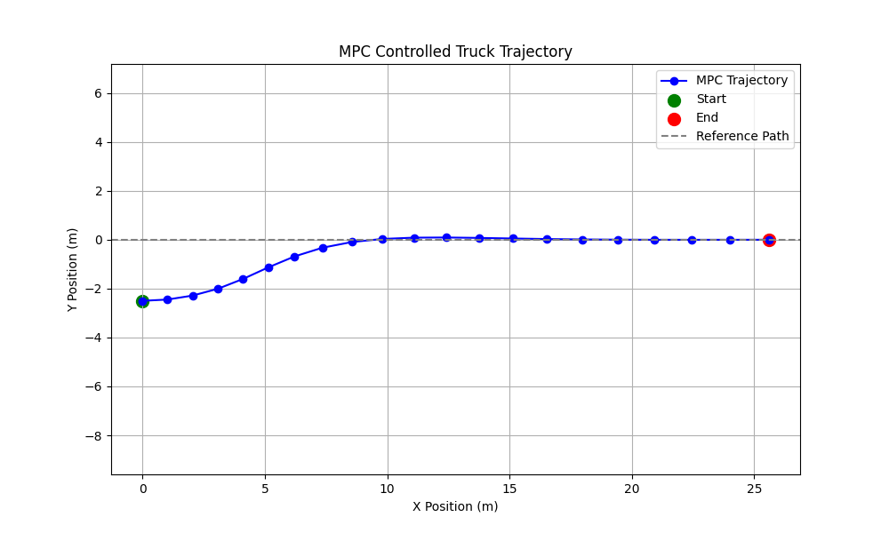

# Hi, I'm Julian

First-year Computer Science student based in Amsterdam, interested in computer vision, deep learning, and autonomous systems.

Primarily working with Python, with a growing focus on C++.

  

## Currently Working On

### VisionPilot

  

**[VisionPilot](https://github.com/visionpilot-project/VisionPilot)** is a modular Python project for autonomous driving research. It combines computer vision, deep learning, and real-time sensor fusion to develop perception and control systems for autonomous vehicles.

#### What VisionPilot Does
- Lane detection (Traditional CV + Deep Learning)
- Traffic sign and traffic light detection and classification
- Vehicle and pedestrian detection
- Multi-sensor fusion (Camera, LiDAR, Radar, GPS, IMU)
- Autonomous vehicle control
- Automatic Emergency Braking (AEB) and adaptive cruise control
- Real-time visualization and telemetry with Foxglove

#### Demos

  

See [VisionPilot on YouTube](https://www.youtube.com/@visionpilot_ai) for additional demos.

 

### Autonomous Truck NMPC

[Autonomous Truck NMPC](https://github.com/Julian1777/autonomous-truck-nmpc) is an early-stage project exploring nonlinear Model Predictive Control (NMPC) for autonomous truck simulation, with a focus on vehicle dynamics, trajectory optimisation, and highway lane selection.

  

 

## Technical Interests

Computer Vision • Deep Learning • End-to-End Learning • Autonomous Driving • Robotics • Sensor Fusion • Motion Planning & Control

## Technologies

**Languages:** Python, C++, MATLAB

**ML & Computer Vision:** PyTorch, OpenCV, YOLO, NumPy

**Tools & Infrastructure:** Docker, Git, Foxglove, BeamNG.tech

## Career Goals

Interested in developing autonomous driving systems, particularly at the intersection of deep learning, computer vision, and vehicle control. Currently exploring perception-based approaches, with end-to-end learning as a future area of focus, and aiming to contribute to robust autonomous systems.

---

  <a href="https://www.linkedin.com/in/julian-stamm/">LinkedIn</a>

